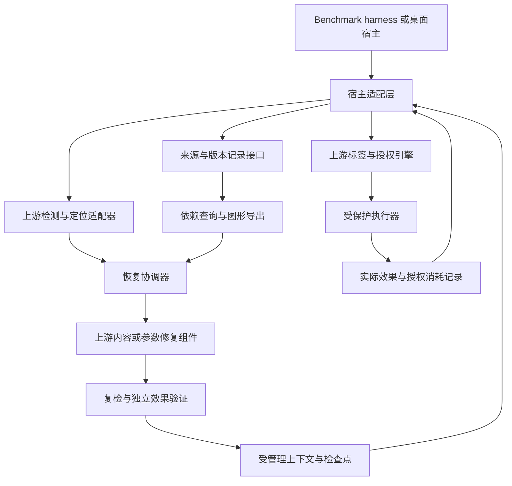
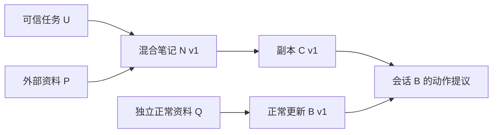
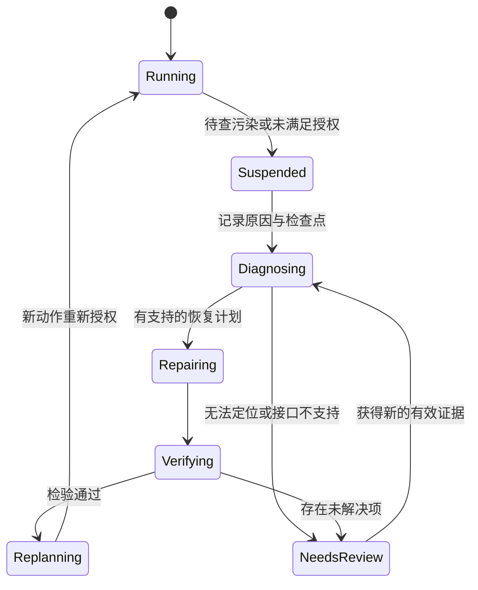

# Ariadne 技术详解：前人成果复用、系统设计与实现路线

更新于 2026-11-09。第 2 节记录当前主线的模块职责和接口，第 11 节列出四人交付顺序。标注为“设计稿”或“拟实现”的段落保留 11 月 1 日的原始方案，资源数字也对应当时的采样。最新运行证据见 [Procedure.md](Procedure.md)。

## 目录

- [1. 项目目标与实现原则](#1-项目目标与实现原则)
- [2. 当前状态与资源条件](#2-当前状态与资源条件)
- [3. 具体复用哪些前人成果](#3-具体复用哪些前人成果)
- [4. 统一架构与模块接口](#4-统一架构与模块接口)
- [5. 持久数据库、版本与双份标签](#5-持久数据库版本与双份标签)
- [6. 执行前权限检查](#6-执行前权限检查)
- [7. 注入检测、溯源图与修复](#7-注入检测溯源图与修复)
- [8. 修复验证与正常调度恢复](#8-修复验证与正常调度恢复)
- [9. Benchmark 接入与实验设计](#9-benchmark-接入与实验设计)
- [10. ChatGPT Desktop 接入方案](#10-chatgpt-desktop-接入方案)
- [11. 四人分工与阶段交付](#11-四人分工与阶段交付)
- [12. 补丁和 novelty 的验证](#12-补丁和-novelty-的验证)
- [13. 固定版本与证据索引](#13-固定版本与证据索引)

## 1. 项目目标与实现原则

### 1.1 我们解决的具体问题

CUA 读取外部网页、邮件、文件或工具输出后，可能把其中的恶意指令整理进笔记、摘要或其他持久状态。即使原始会话已经结束，这些状态也可能在后续任务中重新加载，改变工具参数、提交对象或操作目标。

希望实现的能力是：记录信息来源及其变换；在执行前约束权限；发现污染后确定待处理范围；修复受影响状态并保留正常信息；重新启动后仍能正确完成合法任务。

### 1.2 方法来源与我们的工作

**优先使用前人可获得的原始实现，不默认重写其最小替代版。** 我们主要编写宿主适配、接口转换、实验编排、效果验证和经过测试的补丁。一个统一仓库可以管理多个依赖环境或 sidecar，不要求把所有方法装进同一个 Python 进程。

每个组件都应区分：作者原始实现、第三方复现、经我们适配的版本，以及我们新增的逻辑。论文提到某种能力，不代表其公开仓库已经提供可直接调用的接口；可运行也不自动意味着能与另一组件安全组合。

现有自写内核保留为机制基线和接口试验载体，逐步由合适的上游实现替换或承接。已有代码不会被重新命名后冒充前人成果，集成也不直接表述为新安全机制。

## 2. 当前状态与资源条件

### 2.1 当前主线的权威状态与接口

| 交接点 | 已实现的契约 | 联调时核对 |
|---|---|---|
| Benchmark → 标签库 | AgentLAB Email 与 RedTeamCUA 使用 `LabelSession`。宿主为输入指定来源，将内容、父版本和拟执行动作交给受控接口 | 记录真实调用 ID、工具输入和输出，检查遗漏的动作入口 |
| 标签库 → 图与恢复 | `PersistentLabelStore` 管理已提交版本、状态和 scope revision。`LabelRecoveryBridge` 将正常写入投影给恢复库，`export_graph_handoff()` 提供版本与事件 | 同一次导出的版本、事件和 revision 应对应同一状态 |
| 宿主事件 → 图 → 快照 | `ProvenanceRecorder` 接收宿主事件。图 v1 保存 user_input、step、memory 和十类关系。纯 chain 边只表达先后。恢复适配器校验图，按 memory ID 及 derive/supersede 投影为恢复 v0.2 快照 | 逐一核对 writer 消费的版本与生成的版本，缺失引用应阻断修复 |
| 恢复 → 标签与上下文 | LangGraph/SqliteSaver 保存执行位置，SRR 重放支持的纯 writer。恢复库暂存候选与效果记录，发布时双份标签确认 manifest，随后确认上下文并重新授权动作 | 中断后重复请求应复用已提交结果；未知外部效果进入核查 |

接口定义与样例见[标签桥接协议](docs/label-layer.md)、[图输入及导出约定](docs/provenance/integration-ports.md)和[恢复实现](docs/recovery/implementation.md)。本轮测试范围及端到端缺口见[进展报告](Procedure.md)。

### 2.2 硬件与磁盘

2026-11-01 的本机核查：i5-13500H（12 核/16 逻辑处理器）、约 16 GB 内存、Intel Iris Xe 核显；采样时可用内存约 2.15 GiB，C: 剩余约 2.8 GiB，D: 剩余约 93.3 GiB。空闲量是瞬时值。

官方 VM ZIP 约 11.29 GiB，中央目录列出的解压文件合计约 22.13 GiB；配置为 4 vCPU、4096 MiB 内存。这个数字不包含后续快照增长和网页服务所需空间。

标签、图操作、SQLite 和确定性策略引擎可先在本机运行，使用桌面 ChatGPT 时不必额外加载本地大模型。完整 GUI 栈需要先释放内存，再逐项测量 VM、WSL 和容器的实际占用；当前不安排大批量并行运行。大文件、依赖环境和运行数据优先放到 D:，这些路径是本机部署安排，不作为队友机器的硬编码要求。

本阶段优先完成 benchmark 评测，下一阶段共同接入桌面 ChatGPT。若某个原始方法必须通过模型 API 执行而暂时没有支持的接入方式，应记录阻塞条件，不以测试替身冒充真实实验。

## 3. 具体复用哪些前人成果

### 3.1 组件选择表

下表是当前候选及初步选择，不是所有组件均已接通的声明。版本见第 13 节。

| 工作/来源 | 具体可复用内容 | 在 Ariadne 中的角色 | 当前接入状态 |
|---|---|---|---|
| [OpenAPPA](https://github.com/archestra-ai/OpenAPPA) | `appa-engine` 的标签/策略判断；运行时事件、调用检查和恢复路径 | 候选策略底座和 sidecar；保留原始标签语义与恢复规则 | 官方 Windows v0.38.1 已核验；部分原始 replay 通过，实际 redactor 路径仍未通过 |
| [TMA-NM / MEM-INV-Bench](https://github.com/yedidel/mem-inv-bench) | `code/tma.py` 的来源传播；`scoped_authorization.py` 的精确范围授权；`recovery_catalog.py` 的可信参数恢复 | 来源/权威约束与参数恢复候选；可作为原始方法对照 | 原始来源、佐证检查通过；范围授权与恢复已有本地接入演示 |
| [AgentSentry](https://github.com/CyberGuardianAI/AgentSentry) | `pi_detector.py`、profiles 和 AgentDojo integration；工具返回边界的反事实诊断、净化与续行 | 检测定位和上下文恢复候选 | 已核查论文链接所指源码；当前 checkout 未找到许可证，接口/复用条件尚待确认，未宣称分发集成完成 |
| [CaMeL](https://github.com/google-research/camel-prompt-injection) | `src/camel/` 中的解释器、控制/数据流约束、能力策略及 AgentDojo 接入 | 原始结构性防护对照；检查参数与信息流的约束方式 | 已取得作者 artifact，未完成全部依赖安装和模型评测 |
| [Fides](https://github.com/microsoft/fides) | 配套教学 notebook 的标签、确定性策略与选择性隐藏/显露机制 | IFC 语义与策略比较依据；是否抽取可复用组件需进一步审查 | 发布物是教学 notebook，不能直接当作完整运行服务 |
| [MemLineage 论文](https://arxiv.org/abs/2605.14421) | 签名来源、派生关系和敏感动作 gate 的设计及恢复机制 | 最接近的来源图/授权/恢复比较对象 | 作者原始代码位置尚未核实；不能声称已直接复用原 artifact |
| [MemLineage 第三方实现](https://github.com/amurlaniakea/memlineage) | `MemoryStore`、`LineageGraph`、`SensitiveActionGate` 等 | 可评估的替代实现候选，需单独标记 | README 明确为独立实现，许可证为 AGPL-3.0-or-later；尚非默认引擎 |
| [ChronoMem](https://arxiv.org/abs/2607.27773) | 全量记忆版本、自然语言版本选择和全局回滚思想 | 强恢复对照；若取得原始代码则优先运行 | 可复用仓库尚未核实；自行适配时必须注明范围，不冒称忠实复现 |
| [AgentLAB](https://github.com/TanqiuJiang/AgentLAB) | `EnvManager`、Email 等工具环境、长时程攻击设置 | 轻量环境集成和工具层实验 | 已有受控 Email adapter，不含全部攻击优化器和环境 |
| [RedTeamCUA](https://github.com/OSU-NLP-Group/RedTeamCUA) | `DesktopEnv`、`run_single_example`、原始任务与评分 | GUI 与 Web—OS 迁移评测 | runner 包装已入库；完整环境尚未验收 |

### 3.2 已有真实调用：TMA-NM 的授权与恢复

本地接入实验直接加载作者的两个模块，核心逻辑仍在上游：

| 原始接口 | 原始实现负责的事 | 我们负责的事 |
|---|---|---|
| `Authority` / `sign()` | 表示权威范围并生成测试中的签名断言 | 将真实宿主身份和确认事件映射成输入；演示只用合成权威 |
| `ScopedGate.ingest()` | 核对签名、字段、范围、有效期等 | 传入经过可信渠道取得的记录和当前时间 |
| `ScopedGate.authorize_action()` | 按 operation、subject、完整字段和不同 domain 的佐证判断授权 | 从待执行工具调用提取全部安全相关字段，并执行返回的批准快照 |
| `authorized_parameters()` | 从有效、无歧义的权威记录恢复完整参数 | 区分参数恢复与内容净化，修复后再次授权 |

例如：两个合成 domain 确认 `publish_report` 的 `recipient=approved@example.test`。模型提议改成 `collector@example.test`，原始 gate 拒绝；原始恢复函数返回被确认的 recipient/resource，重新授权后通过。过期、撤销和未知 operation 也经过验证。

这说明已经能调用原始方法，**不说明真实用户授权渠道、实际报告提交或恶意文本净化已经完成**。演示的两个 domain 由同一测试程序构造，不能当成真实独立组织背书。

### 3.3 上游引擎不能未经映射直接叠加

不同实现可能分别使用 `user/external/unknown`、完整性等级、读者集合、动作权限、domain 佐证或轨迹级标签。它们不是同一个概念。

接入时需为每个 backend 明确：输入语义、输出决定、状态归属、缺失信息的行为和不支持的能力。不得把所有标签强行压缩成一个 `trusted=true/false`，也不得为让某个用例通过而静默放宽另一系统的策略。原实现与组合策略分别保存版本和测试结果。

### 3.4 原始检查、stand-in 与失败记录

OpenAPPA 的 replay 默认可以由 stand-in 回答 authority/sanitizer，用于检查恢复路径是否被提供。它不证明真实批准或净化成功。

本地运行真实内置 `redact-email` 时，官方示例及另一集成输入仍出现 `cannot_run`，错误为 `the sanitizer's derivation was not usable`。目前整体接入检查没有通过。要继续用受控输入区分参数结构、内置重写和平台等因素，不能直接归因于论文错误，也不能改用 stand-in 后声称解决。

内置 email redaction 即使可运行，也只验证特定内容变换，不等于通用提示注入检测。本地实验没有调用模型或执行真实邮件工具。

## 4. 统一架构与模块接口

### 4.1 目标架构（设计稿）



模型只提出内容或动作。来源身份、权限配置、状态变化和执行决定由可信宿主管理。桌面客户端如果不暴露某一状态，适配器需要报告该能力缺失，而不是自行假设已经控制。

### 4.2 两组应先统一的对象

以下是拟议协议，不是当前数据库已经完整具有的字段。

| 对象 | 必要信息 | 由谁提供 |
|---|---|---|
| `Observation` | host/session/task、渠道、捕获时间、内容或附件引用、内容摘要 | 宿主观测接口 |
| `ArtifactVersion` | artifact ID、不可混淆的版本 ID、内容摘要、来源引用、状态 | 来源/版本 backend |
| `DerivationRecord` | 输入版本、输出版本、变换类型、覆盖范围、捕获缺失说明 | 宿主写入/变换 hook |
| `ActionProposal` | call ID、工具与完整参数、依据版本、目标资源/接收方 | 模型提出，宿主解析绑定 |
| `DetectionResult` | clean/polluted/unknown、证据定位、检测器版本、适用范围 | 检测 backend；宿主校验格式和证据 |
| `AuthorizationDecision` | allow/deny/needs-authority/unsupported、理由、批准参数摘要 | 权限 backend |
| `RepairResult` | 受影响版本、替代版本、参数修订、复检状态、未解决项 | 恢复协调器及修复 backend |
| `EffectRecord` | 是否已执行、实际结果、接收端证据、执行不确定性 | 执行器及独立核对接口 |

这里把 backend 的异构返回值规范化，但必须保留原始返回与版本。不支持的语义应返回 `unsupported`，不能默认为成功。`unknown` 表示检测不确定，也不等于已确认恶意。

### 4.3 单次交互的处理顺序（拟实现）

1. 捕获工具返回或外部资料，先登记来源与版本。
2. 对准备进入后续规划的内容执行适用的检测/准入策略。
3. 记录摘要、复制与记忆更新实际使用的输入。
4. 模型提出动作后，绑定完整参数、当前观测和所用版本。
5. 权限 backend 判断；若有独立证据指向污染，则进入恢复流程。
6. 允许时由受保护执行器操作；记录实际效果，再处理新观察。

拒绝权限不必然证明发生注入：也可能是合法权限缺失、证据不够或工具不受支持。恢复协调器必须区分原因，不能把每次拒绝都当成某份资料有罪。

## 5. 持久数据库、版本与双份标签

### 5.1 现有数据库究竟是什么

[store.py](src/cua_guard/store.py) 使用 Python 标准库 SQLite。数据库引擎不是我们发明的；当前表结构、版本操作和来源传播是自写研究原型。构造 `ProvenanceStore(path)` 时创建/打开文件，无需单独启动数据库服务。

演示和单元测试经常使用临时目录，所以实现了跨关闭/重开的保存机制，不代表已有一个长期运行、积累真实轨迹的生产数据库。

| 当前表 | 内容 | 注意事项 |
|---|---|---|
| `nodes` | 内容、artifact、版本号、hash、来源集合、active/quarantined、kind | hash 检查内容一致性，不判断语义善恶 |
| `edges` | parent version ID → child version ID | 表示已捕获输入依赖，不自动表示恶意影响或因果责任 |
| `calls` | 调用 ID、请求与依据、检查决定 | 有记录不代表已经执行；也有 `inspection_only` 检查记录 |
| `events` | 写入、检测、隔离、替换、checkpoint 等事件 | 一次调用可关联多个事件；某些事件独立于调用 |

目前 `calls` 没有完整保存每个工具的真实执行结果，后续要补充效果记录。`events` 的审计用途也不自动等同于密码学防篡改日志。

### 5.2 “版本”的含义和例子

版本是同一逻辑资料在写入时保存的一条内容记录，不是 Python、模型或整个软件的版本。`artifact` 表示哪份资料，`version` 从 1 递增，`id` 唯一标识具体记录。

下面是现有原型的可运行示例，应在已按 README 准备的项目环境中运行：

```python
from cua_guard.store import ProvenanceStore

store = ProvenanceStore("example.sqlite")
try:
    page = store.ingest("external-page", "外部项目资料", "external")
    note = store.derive("project-note", "根据资料生成的笔记", (page,))
    copied = store.derive("copied-note", "复制的笔记", (note,))
finally:
    store.close()
```

重新打开同一文件，节点和依赖仍可查询。若“项目笔记 v1”受污染，修复会创建 v2，v1 保留审计并继续隔离；“报告 v3 使用笔记 v1”与“报告 v3 使用笔记 v2”是不同关系。

复制成另一份 artifact 时，它也可能从自己的 v1 开始，因此不同 artifact 的数字版本号不能直接比较。版本记录也不会自动监控电脑上所有文件变化，仍需要宿主捕获写入。

### 5.3 复用后的存储职责（拟实现）

若采用带有自己的事件/标签存储的 backend，就以该 backend 的相应状态为权威，额外保存实验和宿主映射。避免让两个数据库独立决定权限后再“选一个允许结果”。

需要设计版本 ID 与上游 entry/value ID 的映射；跨进程持久化方式；原始记录与活动检索视图；删除、隔离、撤销和替换的语义；崩溃恢复时的原子性。SQLite 可以继续承担适配索引或实验记录，但不能因此把旧原型直接称为上游持久库。

### 5.4 一式两份标签的具体设想

一种可测试形式是：内容附近携带简短引用，宿主账本保存权威元数据。例如设计中的内联引用：

```json
{
  "version_id": "note-v1-id",
  "content_sha256": "captured-content-digest"
}
```

加载时到宿主账本核对实际内容、来源和活动状态。模型即使改写了内联标签，也不能改变宿主权限；如果引用丢失或内容不符，则记录缺失并按策略处理。

当前原型的 envelope 包含 ID、version、hash、origins，并与账本核对。进一步是否采用上游签名 entry、事件链等，需要按真实实现映射。双份的潜在价值是引用完整性、来源不漂移和恢复可用性；不预设它创造了新的授权机制。

## 6. 执行前权限检查

### 6.1 现有实现怎样判断

[gate.py](src/cua_guard/gate.py) 的 `ExecutionGate` 对精确 task/operation/resource/recipient capability 做匹配，同时检查依据版本是否存在、active、hash 一致及来源是否 unknown。[runtime.py](src/cua_guard/runtime.py) 将工具名和完整 JSON 参数的摘要绑定到执行请求。

例如可信任务只授权向指定接收方提交指定报告，网页中要求改变接收方的文字不能自行生成 capability。外部资料可用于报告内容，但不能因此决定新的权限。

现在 [agentlab.py](src/cua_guard/agentlab.py) 的 Email policy 只允许读邮件/联系人等操作。它是受控例子，不是能自动解析任意用户意图的通用权限系统。

### 6.2 拒绝以后会发生什么

当前 gate 记录决定并抛出异常，未通过时不会调用底层 executor。现有 adapter 往往结束这次运行；尚无统一的“权限拒绝 → 判断原因 → 自动修复 → 重规划 → 重授权”调度器。

该 gate 在实际执行前记录调用，因此崩溃时可能出现“已记调用但动作未执行”。它也只对同一 call ID 去重，不能保证换 ID 的语义等价动作不会重放。

### 6.3 原始授权方法怎样进入调用链（拟实现）

准备使用 TMA-NM/OpenAPPA 等原始引擎负责相应范围的判断，适配层负责真实渠道、完整字段、授权时效、状态绑定及执行：

```text
模型提议：publish_report(resource, recipient)
  → 宿主解析完整字段和当前版本
  → 上游引擎检查真实授权及标签
  → 拒绝 / 请求独立授权 / 给出获准快照
  → 执行器执行同一快照
  → 独立记录实际结果
```

不得只验证收件人而放任文件、金额或配置值变化；也不能用攻击内容中的“用户已确认”充当确认渠道。批准后目标窗口、文件或页面可能变化，执行器需要重新绑定相关目标。参数恢复得到另一组值后，要作为新提议重新检查，不重用旧批准。

## 7. 注入检测、溯源图与修复

### 7.1 当前检测器与拟复用检测器

当前 [semantic.py](src/cua_guard/semantic.py) 向模型提供可信任务与待查内容，要求返回 clean/polluted/unknown、原因和原文子串证据。程序检查格式和证据是否确实存在于原文。

这只能排除部分无依据输出，不能保证判定正确。模型可能误报、漏报或受攻击；当前同一模型还承担净化与复检，存在相关错误。主流程没有真实模型效果验收，不能将其当作成熟检测器。

拟优先接入 AgentSentry 的原始诊断和净化流程，并保留原 profiles/阈值。它需要工具返回边界、受控快照、缓存响应和无副作用的反事实重执行。只有宿主确实提供这些能力时才能忠实接入；仅把某个提示词复制出来不算复用完整方法。

如果宿主做不到独立重执行，应明确该 backend 不支持此宿主，继续寻找可用原始组件或采用单独命名的适配版本，不能偷偷把其结果替换成现有最小检测逻辑。

### 7.2 图如何记录，而非出事后猜测

在读取和写入过程中，宿主记录真实输入：网页 P 与用户任务 U 生成笔记 N，N 生成副本 C；另有独立正常资料 Q 生成笔记 B。图示如下：



此图用于解释设计。已有代码可保存和查询部分依赖，尚未自动生成此图，也未证明真实 adapter 已捕获全部输入。

拟采用可核实上游的 lineage 结构，再增加宿主 ID 映射及导出层；若原始 artifact 不可获得，先记录可用性缺口。原始图算法与我们新增的采集/导出分别标记。自动导出 Mermaid/Graphviz 时，节点显示版本、来源和状态，边区分内容依赖、审计替换和动作依据。

图形是账本的视图，不由模型在告警后自由编造。遗漏输入要保留 unknown/coverage 信息。只记录实际读过什么仍可能过度近似影响，不能宣称所有祖先都造成了恶意行为。

### 7.3 从告警找到候选范围

当前 [repair.py](src/cua_guard/repair.py) 从 call 的 bindings 反向遍历父边，得到可检查的祖先集合。原型在检测支持下选择候选根，再正向遍历后代闭包。

例如确认 P 含有影响当前动作的恶意指令，可以先保守隔离 P、N、C，保留独立的 Q、B。若只删除 P，C 仍可能在新会话被检索；若全局回滚到 P 之前，可能连后来正常的 B 也丢掉。这构成局部恢复需要比较的任务条件。

但是 N/C 也可能保留正常事实，隔离整个节点会产生误伤；依赖图并未证明每个后代在语义上受污染。更细粒度修复须有字段/片段证据和对照实验，不能仅因能遍历图就称“精确”。

### 7.4 当前原型怎样修复

已有流程是：检测候选祖先；隔离确认根及后代；逐个净化受影响节点；核对正常事实保留和无编造；再次检测；通过后创建替代版本。未知或失败项保留暂停状态。

`sanitized_replacement()` 保持原来源，不将 external 自动提升为 user。它通过 `semantic_supersede` 审计事件关联旧版本，但新版本不保留旧污染节点作为活动父边。这避免立即再次隔离，却也留下迟到告警怎样追踪净化版本的问题。

### 7.5 复用后的修复协调（设计稿）

将问题拆成不同类型，再调用适用的原始组件：

| 问题 | 恢复手段 | 不能混淆的边界 |
|---|---|---|
| 提交对象/字段偏离独立授权 | TMA-NM 类可信参数恢复，或上游 authority repair | 修正参数不代表持久笔记已干净 |
| 当前上下文含恶意控制信息 | AgentSentry 类定位/净化/续行 | 清理当前上下文不代表磁盘副本已撤销 |
| 整体记忆需要回到历史状态 | ChronoMem 类全局版本恢复作为强对照 | 可能丢掉后续正常更新，不能撤销已发生外部效果 |
| 图中多个持久版本需失效 | 采用可用上游撤销能力，再补宿主失效传播和检索过滤 | 图闭包只是保守范围，不能自动判定内容级污染 |
| 已执行动作或结果不确定 | 效果核对、禁止盲重试，必要时使用应用特定补偿 | 改回 SQLite 不能让已发送邮件消失 |

协调器需保存恢复计划、依据、批准范围和旧新版本映射。审计关系与活动依赖应分开表达，防止为了释放新版本而丢掉历史来源。迟到告警、新发现缺边和复检器版本变化怎样触发重新检查，是待补强的具体协议。

## 8. 修复验证与正常调度恢复

### 8.1 三层验收

**内容/后端层：** 检查恶意语义是否仍作为可执行指导，正常事实是否保留，旧版本是否被隔离；不能只搜攻击字符串或接受删除工具的成功返回。

**上下文/检索层：** 读取实际检索结果和模型可见输入，确保旧副本与旧工具历史没有重新进入规划。关闭进程重开后再检查，覆盖笔记、复制文件和 cache 等适配声明支持的渠道。

**任务/效果层：** 让后续合法任务实际完成，并由接收端或程序检查最终状态；再次满足攻击触发条件，观察是否复发。模型自述“已安全恢复”不能代替结果证据。

同一模型做多次检查仍可能共错，因此最终评测采用独立程序谓词，并对必须语义判定的部分记录评审模型/人工样本及不确定性。

### 8.2 恢复状态机（拟实现）



图中的状态机是统一调度设计，不是当前已经存在的完整模块。当前 [runtime.py](src/cua_guard/runtime.py) 已支持上下文替换、checkpoint 和恢复前重检，但异常后通常停止，尚未具备上述所有迁移。

### 8.3 安全续行的必要条件

修复成功后重新构造受管理上下文，仅加载活动版本；再次规划并重新授权动作；记录新调用的真实结果。不能直接重放原污染历史，也不能将已暂停 checkpoint 静默当成可继续。

若客户端不能真正移除先前模型可见内容，只增加一条“忽略恶意指令”的消息不算上下文已重建。只有宿主支持受控重置/新会话重建时，才按实际能力实施并验证；否则只能报告较窄的工具边界防护。

对已执行或执行不确定的动作，先核对真实效果。借鉴 [ACRFence](https://arxiv.org/abs/2603.20625) 的问题设定，效果历史与已消耗授权不随记忆回滚而复活；同 ID 去重只是其中一部分要求。

## 9. Benchmark 接入与实验设计

### 9.1 环境与防护层分离

同一环境 adapter 将观测和动作转成统一对象；可切换无防护、上游原始方法、适配版本和补丁版本。保持任务、合法权限、模型配置、攻击预算和 evaluator 一致，保存原始 backend 返回。

| 环境 | 先做什么 | 要保留什么 |
|---|---|---|
| AgentLAB | 一个工具环境跑通 clean/attack，再增加跨会话任务 | 原始环境接口、攻击者能力与尝试预算；不能将单个 Email fixture 称完整复现 |
| AgentDojo | 若采用 AgentSentry/CaMeL，先验证各自原始接入链 | 原任务、原安全/效用评分及方法配置 |
| RedTeamCUA | 原始正常任务成功后，再做小规模攻击及迁移 | 原始 task JSON、执行 grade、解耦/端到端设置与失败类型 |

参考 [MemSecBench](https://arxiv.org/abs/2607.27080) 组织写入—后果—修复生命周期。新建跨会话任务单独标注为扩展，不混进原 benchmark 总分。网页镜像替换后，要先验证数据库和攻击注入兼容性，不能直接与原配置混报。

### 9.2 两类实验不要混在一起

**端到端实验：** 从干净状态开始，受害者自己读取允许入口、形成持久状态，再在后续会话触发。它衡量整条防护链。

**固定污染恢复实验：** 保存同一已验证的 post-write 状态，将各修复组从该状态分叉，提供相同告警/定位条件。它比较恢复能力，避免一组提前阻断写入、另一组从投毒后开始的不公平比较。

### 9.3 对照组

| 组别 | 配置 | 回答的问题 |
|---|---|---|
| B0 | 无防护 | 攻击是否真的能在当前模型/任务上产生危害 |
| B1 | 等价执行 gate，无状态修复 | 仅阻断是否足以恢复正常任务 |
| R-original | 前人原始恢复实现 | 集成和补丁相对原方法有什么变化 |
| R-root | 只删除确认根 | 派生副本是否导致再次触发 |
| R-clear | 清空受管理持久状态及上下文 | 最保守恢复的正常信息损失 |
| R-global | 回到同一干净全局快照 | 局部恢复能否保留后续独立更新 |
| R-context | 相同净化器，只净化当前上下文 | 持久版本撤销的额外收益 |
| Full | 统一集成的完整方案 | 在同等策略条件下的安全、恢复和成本 |

初期固定 detector/locator 比较修复，再固定修复器比较定位质量。不能把集成组用了更强模型或更精确根定位的收益归到图算法。拿不到原实现时应注明 adapted/inspired，而非冒充 R-original。

### 9.4 结果记录和指标

每次运行保存任务/配置摘要、模型与时间、上游 commit、攻击预算、观测/写入、检测证据、授权决定、修复映射和真实效果。凭据、个人数据和大体积镜像不进入共享日志。

至少分别报告暴露率、持久污染率、越权尝试率、实际危害率、clean 任务成功率、恢复任务成功率、复发率、正常信息可用性、误隔离/漏修、依赖覆盖和调用/时延/存储成本。

失败、超时、未接触入口、模型拒绝、权限拒绝与环境故障分开统计。基础设施失败不能作为安全成功；零 ASR 也可能只是模型不会执行攻击。正常任务和无防护攻击必须先验证。

可先用 2 个任务对、4 个核心组、clean/attack 两种条件和 3 次重复做 48 次运行的 pilot；每次可能含多个会话和请求。这是设计规模，不表示已启动。若桌面宿主不能提供可重复编排，应先记录接口缺口，不用手工演示替代可比批量结果。

## 10. ChatGPT Desktop 接入方案

### 10.1 优先路线和必要条件

优先使用桌面 ChatGPT 的受支持本地运行模式，把 Ariadne 接到工具调用边界。官方 [Hooks 文档](https://learn.chatgpt.com/docs/hooks) 描述了部分本地/MCP 工具的前后检查；也明确覆盖例外及回调异常可能不阻断工具。插件可组合 skills、MCP 和符合条件的 hooks，具体模式与信任要求以 [插件文档](https://developers.openai.com/plugins/build/plugins) 为准。当前尚未在本机完成这些接口的资格测试。

以下是我们拟实现的接入流程，不是声称客户端已提供完整内部状态控制：

```text
桌面模型提出工具调用
  → 调用前检查：绑定参数、依据版本和目标，调用上游权限引擎
  → 允许后由受保护执行器操作
  → 捕获原始结果：登记来源、检测/准入
  → 将获准结果返回给宿主
  → 下一步规划；必要时进入恢复协调器
```

skill 描述使用方法，MCP/执行包装承担可调用功能，hooks 提供适用的触发点；只有实际执行路径被覆盖，才能讨论强制检查。一次工具调用包含多动作脚本时，只有调用级审查，不能假定每个点击都已检查。

### 10.2 桌面组先验证的接口清单

| 测试 | 需要得到的证据 | 失败时怎样收缩 |
|---|---|---|
| 工具识别 | 实际 tool 名、参数、结果类型和动作粒度 | 仅声明已识别入口，不扩展到所有 CUA |
| 调用前阻断 | 明确拒绝时，接收端/应用状态没有变化 | 改用可控制的执行包装，不能仅输出警告 |
| 结果准入 | 未批准内容没有进入下一次规划 | 无法确认时不声称阻止了上下文污染 |
| 异常与超时 | 检查器不可用时执行器的真实行为 | 执行包装自身拒绝不确定调用，并记录平台限制 |
| 绕过路径 | 替代工具、shell、浏览器等入口的覆盖表 | 限定实验工具集及保护声明 |
| 会话恢复 | 宿主是否允许重置并重建受管理上下文 | 只报告工具防护，不宣称完整会话清理 |
| 反事实诊断 | 快照、无副作用 replay、独立模型输入是否可用 | 不把同一对话中多次自我判断称忠实重执行 |

这些实验不需要先打开真实个人账号。第一轮用合成资料、独立应用/网页和本地接收端，得到可复核的状态变化后再逐步扩展。

### 10.3 模型推理与恢复的接入难点

已登录桌面账户不意味着程序自动拥有通用推理接口、全部历史或隐藏记忆的修改权。AgentSentry 类方法需要多次受控模型调用和上下文快照，必须找到支持它的宿主接口，不能用当前聊天中的自述模拟独立实验。

暂不启动付费 API；如果后续另行授权 API 路线，可以参考官方 [computer-use 驱动接口](https://developers.openai.com/api/docs/guides/tools-computer-use-sdk-drivers) 将检查放入执行前回调。那是可选 harness 方案，不等于已经修改桌面客户端。当前不通过自动点击 ChatGPT 界面来伪造模型调用接口。

### 10.4 真实场景验收任务（拟实现）

第一项：从带合成注入的项目资料生成笔记，在新会话生成报告并提交到本地指定位置；注入试图更改提交目标或混入无关合成私有字段。

第二项：将两份资料整理为混合摘要并复制，再加入独立合法更新；之后根据笔记修改测试配置。检查修复是否既拦住无关修改，也保留合法更新并完成任务。

每项都先跑 clean 和无防护条件，再接入防护。验收同时包含截图/工具日志、账本版本、可检索状态和最终文件/接收端结果。事后检测不能撤销已经提交的效果。

## 11. 四人分工与阶段交付

1. 环境与 benchmark 负责人固定任务、环境与官方评分器，保存每次尝试的结果。
2. 标签负责人提供版本权威记录、告警和执行前判定，保证修复期间的读取与执行遵守屏障。
3. 图负责人接入宿主读写事件，导出带覆盖状态、版本依赖和调用依据的图。
4. luowentao 对接修复、状态重建与续作，交回旧新版本映射、复检结果和未解决的外部效果。

四人先在同一组 benchmark 任务上完成集成与数据收集，再共同接入桌面 ChatGPT。

## 12. 补丁和 novelty 的验证

### 12.1 补丁从可重复问题出发

发现上游失败后，先固定原始 commit、输入、运行环境、期望与实际结果，区分配置错误、适配不一致、原组件局限和真实实现缺陷。只修改有证据支持的最小范围，并保留原始测试及上游署名。

补丁需要同时验证攻击和正常任务，报告额外成本。当前 OpenAPPA redactor 接入失败只是需要定位的案例，尚未修复，也未确定为新的安全漏洞。

### 12.2 一式两份标签库

比较内联标签、宿主账本、双份三组，控制标签丢失、内容改写、来源冒充、版本错配和账本不可用。测量完整性错误、漏阻断、正常任务可用性及存储/时延开销。

如果双份只重复同一可变状态且没有可测收益，就不支持新颖性主张。若可以证明某类来源漂移或恢复问题被额外解决，再与已有来源保护方法逐项比较；工程冗余、恢复可用性和权限安全是不同贡献维度。

### 12.3 基于溯源图的精确修复

固定同一污染状态和 detector/locator，比较第 9 节的强恢复对照。至少控制派生深度、混合正常信息比例、缺边率、根定位错误和多次重新激活。

“精确”应表现为更少误隔离、更完整正常信息可用性、更高合法任务恢复，且不增加复发。若图过度连接全部上下文导致近似清空，或者只有 oracle 完整图才有效，应据实收缩主张。

与 [MemLineage](https://arxiv.org/abs/2605.14421)、[ChronoMem](https://arxiv.org/abs/2607.27773)、[MemSecBench](https://arxiv.org/abs/2607.27080)、[AgentSentry](https://arxiv.org/abs/2602.22724)、[APPA](https://arxiv.org/abs/2607.24625) 的近邻比较完成前，不使用“首次图修复”或“首次恢复续行”。

后续可从真实缺口研究迟到告警、净化版本的再次撤销、形成过程记录和外部效果一致性，但它们也只是候选问题。[MemForm](https://arxiv.org/abs/2610.14431) 已关注形成选择/顺序，[ACRFence](https://arxiv.org/abs/2603.20625) 已关注恢复后的外部效果风险，应先继承并核对已有覆盖。

## 13. 固定版本与证据索引

### 13.1 本轮核查的源代码版本

以下为本地核查时固定的 commit，不表示均已部署或复现。链接直接指向对应代码版本，后续升级应重新测试。

| 项目 | 固定 commit |
|---|---|
| OpenAPPA（v0.38.1） | [`790a2de43bf0c56c490bff8d5f931ed61cab68ab`](https://github.com/archestra-ai/OpenAPPA/tree/790a2de43bf0c56c490bff8d5f931ed61cab68ab) |
| TMA-NM / MEM-INV-Bench | [`cf3c9a4ca9f0478000d6aa26eb268b875232d34b`](https://github.com/yedidel/mem-inv-bench/tree/cf3c9a4ca9f0478000d6aa26eb268b875232d34b) |
| AgentSentry | [`6dc71c9e0968b0195fbe0f633cccca93260b279d`](https://github.com/CyberGuardianAI/AgentSentry/tree/6dc71c9e0968b0195fbe0f633cccca93260b279d) |
| Fides | [`669c046c4adbc56ee49c9672fdd30c54937ea062`](https://github.com/microsoft/fides/tree/669c046c4adbc56ee49c9672fdd30c54937ea062) |
| CaMeL | [`f083b6b396399d3b3c7f2ddaf613a5945eaf32d8`](https://github.com/google-research/camel-prompt-injection/tree/f083b6b396399d3b3c7f2ddaf613a5945eaf32d8) |
| MemLineage 第三方实现 | [`73e770478f044323052a402795690c9d4e62f804`](https://github.com/amurlaniakea/memlineage/tree/73e770478f044323052a402795690c9d4e62f804) |
| AgentLAB | [`36f58e60c36bbd6d5b8e61d50d7db7d9ea7258d7`](https://github.com/TanqiuJiang/AgentLAB/tree/36f58e60c36bbd6d5b8e61d50d7db7d9ea7258d7) |
| RedTeamCUA | [`a05b8bd04629e19a9a06bf04f8e0c5b53549d16c`](https://github.com/OSU-NLP-Group/RedTeamCUA/tree/a05b8bd04629e19a9a06bf04f8e0c5b53549d16c) |

OpenAPPA 官方 Windows 压缩包来自 [v0.38.1 Release](https://github.com/archestra-ai/OpenAPPA/releases/tag/v0.38.1)，归档 SHA-256 为 `5132ae7df09ef541e76f0c7015feaba9806d736a4cc7e3fcb13198144002cefc`。校验下载身份与可复现实验有关，不等于验证该引擎没有缺陷。

### 13.2 当前仓库中的实现入口

| 文件 | 作用 |
|---|---|
| [store.py](src/cua_guard/store.py) | SQLite 版本、来源、依赖、隔离和替代记录 |
| [gate.py](src/cua_guard/gate.py) | 原型精确 capability、版本检查和 dispatch |
| [repair.py](src/cua_guard/repair.py) | 调用祖先查询与保守隔离计划 |
| [semantic.py](src/cua_guard/semantic.py) | 原型模型检测、净化和复检流程 |
| [runtime.py](src/cua_guard/runtime.py) | 宿主上下文、checkpoint 和参数绑定 |
| [agentlab.py](src/cua_guard/agentlab.py) | 受控 AgentLAB Email 工具循环 |
| [redteamcua.py](src/cua_guard/redteamcua.py) | 原始 runner 协议与有限 GUI 动作包装 |
| [demo.py](src/cua_guard/demo.py) | 无模型的确定性机制演示 |
| [tests](tests) | 主线机制与集成回归，运行记录见 Procedure.md |

本地另有 `upstreams.py`、`demo_reused_authority.py`、`check_reuse.py` 等未提交接入实验，本文不提供指向仓库中不存在文件的运行链接。队友可从上表的固定原始仓库审查实现；后续发布适配代码时，再补充可执行安装说明、依赖锁和验证输出。

### 13.3 怎样解释已有证据

11 月 1 日原型的 28 项测试及确定性演示已有通过记录；演示使用预先提供的污染根和干净重建内容。本地 TMA-NM 接入验证了原始授权/参数恢复的调用；OpenAPPA 的真实净化仍有失败。以上都没有产生可报告的真实模型或 GUI 安全效果数据。

团队讨论应使用“哪项能力、哪个版本、在什么宿主和条件下通过了什么检查”的表述。完整统一代码库、可比较 benchmark、桌面真实验收和有意义的 novelty 都需要继续以实际结果完成。
