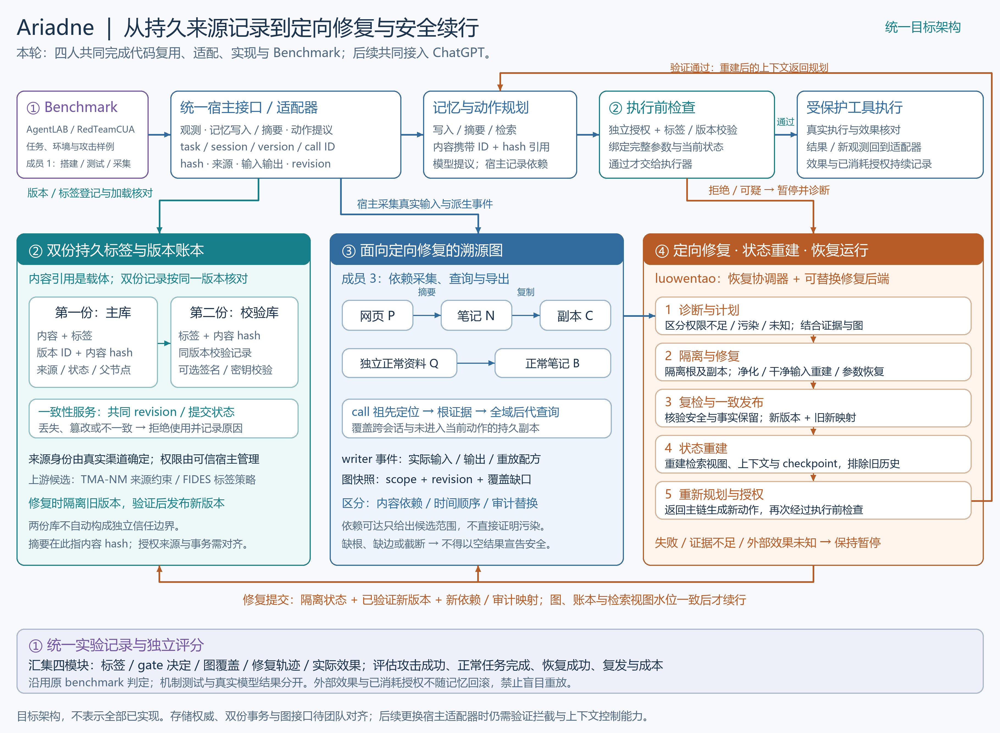

# Ariadne

Persistent provenance and targeted repair for computer-use agents.

阿里阿德涅之线：沿来源与版本依赖，定位污染并恢复任务。插件及仓库正式名称为 **Ariadne**，Python 分发名为 `ariadne-cua`；内部导入名保留 `cua_guard`。[GitHub 仓库](https://github.com/Computer-Security-PP-TR-for-CUA-ast-LHA/Ariadne)设为 Private，供团队协作。

详细的组件复用清单、数据库与标签设计、检测修复流程、benchmark 和桌面接入方案见 [Details.md](Details.md)。

## 当前方向：复用、集成与补强

**2026-11-02 更新，按组内讨论后的四人分工执行。** 项目面向 CUA 的跨会话持久状态污染，优先复用前人已有的标签、溯源图、权限控制、检测与修复成果，形成统一代码库，再接入 benchmark 和桌面 ChatGPT 做验证。

能复用的组件先检查原始代码、版本、依赖、许可证和运行结果，再接入。后续不再默认从头编写相关方法的最小替代实现；现有自写内核保留为机制原型和对照。复用也需要实测，不能只凭论文结果或仓库名称假定效果可靠。

当前阶段由四人共同完成**代码复用、适配与实现，以及 benchmark 测试和数据收集**；完成本轮验收后，再共同开展 ChatGPT 接入与真实场景验证。完成复现、评测和真实场景验证后，再根据失败案例寻找前人尚未提出或处理不好的问题，决定是否形成新的研究贡献。集成与适配的研究价值也需要证据支持。

## 优先任务与阶段验收

| 优先级 | 任务 | 主要交付与验收 |
|---|---|---|
| **0** | 确认硬件与硬盘资源 | 核对 CPU、内存、磁盘、VM 和网页服务需求；明确本地能运行的实验规模及资源缺口 |
| **1** | 复用前人方法，集成为统一代码库 | 接入可核实的标签、溯源图、检测与修复实现；固定来源与版本，保留原测试，明确组件间的数据和权限语义 |
| **2** | 引入 RedTeamCUA 等 benchmark | 跑通正常任务与攻击任务，保留原任务及评分；建立无防护、原始方法、集成方案之间的对照 |
| **3** | 适配 ChatGPT，并进行真实场景测试 | 优先桌面 ChatGPT；验证工具调用前检查、结果准入、持久状态记录、修复与续行，以及异常和绕过路径 |
| **4** | 为前人方法补丁，并探索新 novelty | 从可重复失败案例出发，比较修改前后安全性、正常任务效用和成本，再实现有依据的新方法 |

“统一代码库”指统一接入接口、实验入口和结果记录；依赖不兼容的组件可以使用独立环境或 sidecar。直接复用、适配修改、第三方复现和我们新增的代码需要分别标注，避免混淆原方法与集成方案。

## 已有工作与当前缺口

| 部分 | 当前状态 |
|---|---|
| 机制原型 | 已有 SQLite 版本/来源账本、依赖查询、执行门、隔离与重建、checkpoint；28 项自动测试已有通过记录 |
| 模型与实验适配 | 已有 DeepSeek 客户端、语义检测/净化流程代码、AgentLAB Email 适配及 RedTeamCUA 执行包装 |
| 前人成果复用 | `luowentao` 已提供固定版本 TMA 参数恢复与 SRR 原生计划 adapter、恢复组件和离线续行入口；完整真实 benchmark 集成仍待验收 |
| 完整 benchmark | 尚未完成真实模型端到端评测与完整 GUI 环境验收；没有可报告的真实模型 ASR 或方法优越性结果 |
| 桌面 ChatGPT | 尚未完成插件/harness 接入及真实场景验收；需先核实宿主提供的工具拦截和上下文管理接口 |

此前实现范围和环境记录见 [Proposal 实施记录](docs/proposal-implementation.md)，该文档是历史阶段记录，后续工作以本 README 的复用优先路线为准。ChatGPT 接入安排在本轮 benchmark 之后。**暂不启动付费 API 实验**；真实模型评测需要另行确定可用的模型调用方式与预算，离线机制测试不等于真实 benchmark 数据。原 API 客户端保留作为可选路径。

## 本机资源与运行安排

以下为 2026-11-01 的本机核查记录，可用内存和剩余磁盘是采样值，会随运行状态变化。

| 项目 | 核查结果 |
|---|---|
| 系统与 CPU | Windows 11；Intel i5-13500H，12 核/16 逻辑处理器 |
| 内存 | 约 16 GB；采样时可用约 2.15 GiB |
| GPU | Intel Iris Xe 核显；未检测到独立 NVIDIA GPU |
| 磁盘 | 采样时 C: 剩余约 2.8 GiB，D: 剩余约 93.3 GiB |
| 核心环境 | 项目内 Windows `.venv`，Python 3.13.5；SQLite 无需独立数据库服务 |
| GUI 实验环境 | 已有专用 WSL2 `AriadneLab`、RedTeamCUA Python 3.12.6 依赖环境及官方 VM 压缩包；完整服务链尚未就绪 |
| 官方基础 VM | ZIP 约 11.29 GiB，列出的解压文件约 22.13 GiB；默认 4 vCPU、4096 MiB 内存 |

本机可开展轻量标签/图/策略引擎集成、离线验证和小规模串行工具实验，无需为复用这些方法而部署本地大模型。完整 RedTeamCUA 的 VM、网页服务及快照更占资源：先释放内存并核算磁盘，再逐项启动和测量，不预设所有服务可以同时稳定运行。新增大体积资源优先放到 D:，不把个人机器路径作为队友必须采用的配置。

## 本轮框架与四人分工



这是基于 proposal 扩展的**目标架构**，不表示所有能力已实现。保留持久标签库、面向定向修复的溯源图和溯源定向修复三块核心，补充恢复调度、检索/上下文重建、重新授权和效果验证。图源生成脚本见 [draw_integrated_architecture.py](scripts/draw_integrated_architecture.py)；图片为 PNG，无需 Mermaid 渲染；另附 [SVG 矢量版](docs/assets/architecture-integrated.svg)。

| 成员 / 模块 | 本轮职责 | 交接内容 |
|---|---|---|
| 成员 1：环境与 Benchmark | 环境搭建、运行器适配、正常/攻击任务、数据收集与独立评分 | 稳定观测/动作协议、固定污染快照、效果记录、结果格式 |
| 成员 2：双份标签与执行前检测 | 内容侧引用与宿主权威账本、版本状态、执行前检查 | 版本 ID/hash、来源与权限、结构化告警、隔离/新版本写入接口 |
| 成员 3：溯源图与导出 | 真实依赖采集、版本图、祖先/后代查询、图形导出 | 图快照、调用依据、全域后代、覆盖缺口与审计关系 |
| **luowentao：定向修复与恢复** | 修复协调器、内容/参数修复后端适配、状态重建、checkpoint 与恢复运行 | 修复计划、旧新版本映射、未解决项、复检记录、恢复状态 |

下一阶段由四人共同开展 ChatGPT 接入；本轮不再按“Benchmark 两人、ChatGPT 两人”拆组。Details.md 中原两组并行安排属于历史设计，当前阶段顺序与职责以本节为准。

`luowentao` 分支的默认恢复链已使用 **LangGraph 持久编排、SqliteSaver 检查点、filelock，以及 SRR 原始 writer 重放**，项目层保留隔离/验证/原子发布/双标签 ACK/授权与效果约束。完整 [源码审查、替换依据及运行方法](docs/recovery/reuse-audit.md) 已入库。安装 `pip install -e ".[srr]"` 并设置固定版本 `ARIADNE_SRR_CHECKOUT` 后运行 `python -m cua_guard.recovery.demo`；缺少上游不会静默回退到自写重放器。图协议仍为 v0.2，图组的真实适配器和正式 benchmark 评分尚待联调。

### 第二部分本地集成

双份标签与版本服务是已提交版本 ID、状态和 scope revision 的准源。`label_store.py` 在主库与校验库中同步提交；`label_bridge.py` 把记录投影给恢复模块，并通过 `LabelOwnedRecoveryStore` 接受隔离计划。修复候选留在恢复模块暂存，`LabelRepairProjection` 验证并提交新版本，双库和恢复投影一致且上下文确认后才能续行。`label_runtime.py` 在实际工具动作前核对宿主授权、参数及证据版本，返回结构化告警。详细契约、论文复用与限制见[标签层说明](docs/label-layer.md)及[第三方声明](THIRD_PARTY_NOTICES.md)。

AgentLAB Email 的固定版本环境已用脚本模型跑通正常任务、注入后修复和越权发信拦截；RedTeamCUA 的包装器通过合成屏幕动作测试。这些是本地接线检查，尚无真实模型攻击成功率或完整 GUI 评分。

执行门拒绝首先触发原因诊断：权限不足、污染和未知须区分。图边记录已捕获输入依赖，不自动证明恶意因果。确认污染后保守隔离根及所有已捕获的受影响副本；验证新版本后重建检索视图、上下文与检查点，重新规划并再次经过执行门。失败或证据不足则保持暂停；回滚状态不撤销已发生的外部效果，也不恢复已消耗授权。

### 可以并行开发的接口边界

先约定 `version_id`、内容 hash、`call_id`、图快照/revision、祖先与全域后代查询、缺边标记、修复结果及旧新版本映射。图的数据库实现和导出样式无需先定版。恢复模块通过协议与适配器访问图和账本，不直接依赖内部 SQL 表；合成图可用于契约测试，真实图接入后再做端到端验收。

告警后的定位、净化和复检由恢复模块协调可替换后端；执行前告警由成员 2 提供，检测配置和评测条件由团队共同统一。依赖可重放时按拓扑顺序从已验证输入重建；不可重放时明确记录净化或缺失范围，不把隔离、删除或重试直接当作恢复成功。

## 待验证的原始设想

以下保留为研究假设，尚未确认具有有意义的 novelty：

| 设想 | 需要回答的问题 | 验证方式 |
|---|---|---|
| **一式两份标签库** | 双份记录相较单份，是否改善标签丢失、摘要后的来源漂移、篡改检测或恢复？第二份是否提供有效的信任/恢复边界？ | 比较内联标签、宿主账本、双份三组，控制丢失、篡改与版本不一致，同时测量成本；同一信任域中的双份记录不自动产生安全保证 |
| **基于溯源图的精确修复** | 能否在去除污染和派生副本的同时，保留更多正常信息、恢复合法任务并降低后续复发？ | 在相同污染状态、告警和权限下，对比前人原始修复、只删根、全局回滚、清空状态与图局部修复；测误隔离、漏修、正常信息可用性和成本 |

已有依赖边不等于证明语义因果关系，节点级隔离也不等于内容级精确修复。若上述设想没有增益，或已被近邻覆盖，就据实调整贡献定位；新增 novelty 从复用、benchmark 和真实场景中暴露的问题继续寻找。

## Quick start

以下是已入库的机制原型测试和演示入口。演示不调用真实模型，不代表完整 benchmark 或桌面接入已完成。

Windows PowerShell：

```powershell
.\scripts\bootstrap.ps1
.\.venv\Scripts\python.exe -m cua_guard.demo
.\.venv\Scripts\python.exe -m unittest discover -s tests -v
```

Linux（Python 3.11+）：

```bash
bash scripts/bootstrap.sh  # 已有 uv Python 3.13 时离线建 .venv-wsl
bash scripts/check.sh
```

Windows 脚本创建项目内 `.venv`，通过 `.pth` 引用源码，不更改系统 Python。历史原型仍可单独运行；当前恢复模块及全量测试需要先执行 `python -m pip install -e ".[srr]"` 安装固定版本运行依赖，首次安装需要联网，不需要 API key。测试环境约束见 `requirements/recovery-tested.txt`。

## Modules

| 模块 | 当前功能 |
|---|---|
| `store.py` | SQLite 版本节点、内容摘要、来源集合、派生边、审计事件、内联 envelope 校验 |
| `gate.py` | task/operation/resource/recipient 精确权限检查、版本状态检查、调用 ID 去重、宿主执行包装 |
| `repair.py` | 按调用找祖先候选；接受独立确认的污染根，隔离根及后代 |
| `model.py` | DeepSeek Flash JSON、tools、vision HTTP 调用；超时、调用次数与输出长度限制 |
| `semantic.py` | 有原文证据的检测、候选祖先定位、保守隔离、语义净化及双重复检 |
| `runtime.py` | 宿主拥有的上下文、持久化 checkpoint、恢复前复检、参数摘要绑定 |
| `label_store.py` / `label_bridge.py` / `label_runtime.py` | 双份权威标签与版本、恢复投影及执行前检查；新 benchmark 入口使用此链路 |
| `agentlab.py` | 锁定版本的真实 EnvManager/Email 环境及有界工具循环 |
| `redteamcua.py` | 原始 run_single_example 协议适配、视觉感知、有限动作编译与执行包装 |
| `demo.py` | 会话重启、污染派生复制、阻断、局部隔离和重建演示 |

## Trust boundary and limits

- 数据库与 policy 由可信宿主控制。当前库没有防止同账户进程篡改 SQLite 的能力；同目录双份记录不等于安全隔离。
- 来源表示渠道，不判断语义善恶。外部资料在独立授权的动作范围内仍可作为数据使用。
- 图记录已捕获输入依赖，不能称为已证明的 causal graph。所有父节点依赖由宿主采集，不能信任模型报告。
- `semantic.py` 现在自动检测与净化；模型判断是可出错的证据，不是安全证明。相同模型承担检测与复检，可能有相关错误；需要后续真实实验测量。
- 隔离以节点为单位，混合摘要中的正常信息也可能暂时不可用。内容级精确修复尚未实现。
- 当前仅支持单进程研究流程。GUI 视觉感知可能漏读，屏幕也可能在观测后变化；尚不能保证任意桌面副作用安全。进程隔离和副作用补偿仍不具备。
- `dispatch` 在检查后记录调用再执行，崩溃可能导致调用未执行但被标记使用。不要自动重试不确定的外部动作。
- AgentLAB 示例仅允许读模拟邮件与联系人；GUI 仅在专用实验虚拟机中运行，禁止直接执行模型生成的 Python。

## Research and collaboration

仓库 `docs/research/` 保存此前的调研副本，`docs/architecture.md` 和 `docs/proposal-implementation.md` 记录已有原型及边界；早期路线若与本 README 不同，以这里的 2026-11-02 更新为准。工作区另有 `项目调研/相关文献/` 和 `项目调研/文献综述/`，论文 PDF 与新增笔记尚未全部纳入本仓库。

团队流程见 [CONTRIBUTING.md](CONTRIBUTING.md)。已有 [PR #1 的 CI](https://github.com/Computer-Security-PP-TR-for-CUA-ast-LHA/Ariadne/actions/runs/41052088365) 通过 Windows/Ubuntu × Python 3.11/3.13 四组检查，覆盖当时的 28 项测试与机制演示；这不代表完整安全效果评测通过。

`luowentao` 的通用实现替换已通过 [五项跨平台 CI](https://github.com/Computer-Security-PP-TR-for-CUA-ast-LHA/Ariadne/actions/runs/41451944312)，干净安装包全量测试 98 项通过、无跳过。源码选型、默认 LangGraph/SRR 接入、复用边界和可复现记录见 [复用替换审查](docs/recovery/reuse-audit.md)。

许可证待四位成员共同确定；当前没有授予开源再分发许可。引用外部代码时需单独遵守其许可证。
