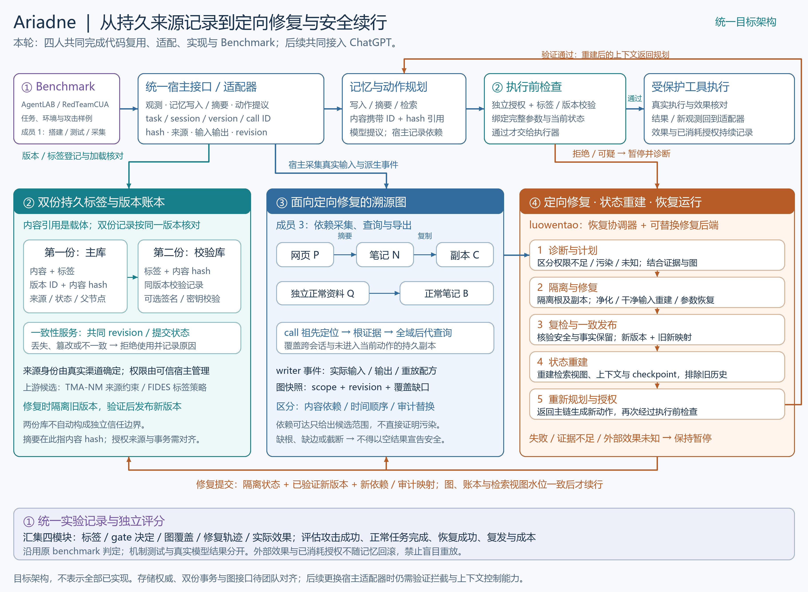

# Ariadne 项目进展

## 2026-11-20：中期后转入最终答辩准备

中期答辩已完成。依据 11 月 17 日 Progress Meeting PPT 与项目提出者说明，将后续工作明确为 RedTeamCUA、ChatGPT Desktop 接入、AgentDojo 诊断与改进三条并行线。第三条由本次计划提出者负责，详见 [路线](roadmap.md) 与 [实施计划](research/agentdojo-diagnosis-plan.md)。

本次完成旧 AgentDojo 原始日志的离线再分析：1,148 条记录、97 对正常任务与 463 条修复续行。207 条续行失败中 188 条含拒绝、19 条无拒绝；13 条续行成功也含拒绝，因此不将拒绝直接标为因果误拦截。已记录全参数参考授权、恢复/门控混杂及实验后邮件策略变化三个优先排查点。[提取数据与命令](../reports/agentdojo_diagnosis_20261120/README.md)

本次没有调用模型重跑，没有修改核心策略，没有完成新的桌面或 RTC 验收。下一项是代表案例的反事实复现与运行清单/轨迹补齐。以下各日期记录继续保留历史语境。

## 2026-11-14 交接记录

本页保留 11 月 14 日的交接记录。11 月 15 日更新的评测结果与验收材料见[项目首页](../README.md)。

## 中期答辩验收清单

| 工作 | 现有成果 | 答辩前待补 |
|---|---|---|
| 代码与合并 | 双份 SQLite 标签库、动作执行门、来源与派生图、LangGraph 恢复检查点及定向修复已有实现。AgentLAB 与 RTC 适配入口已纳入同一代码库 | 用同一次正常任务的观测、标签、图、修复及最终评分验证跨组件接口 |
| Benchmark | 团队 Ubuntu VM 完成三平台各 288 份配置预检，所有 ID 通过。Windows 宿主端另有 RTC Ubuntu 来宾和本机 Reddit 服务 | 两台环境分别核对依赖、用户权限、GUI、快照、网页初始状态和 runner 的模型接口 |
| 检测与数据 | DeepSeek 检测 864 个条目，429 份不同文本。有效检出 Reddit 288/288、OwnCloud 284/288、Rocket.Chat 288/288。另有 18 个正常输入均判 clean，其中 12 个为人工对照 | 复核 OwnCloud 四项引文定位失败，补充真实正常文档和聊天输入；Rocket.Chat 检测输入为模拟联系人提示 |
| 任务效用 | DeepSeek 在 AgentDojo 12 个只读任务上运行两组，普通与标签门均为 6/12。RTC Reddit 三个正常目标各两种表述已由模型读宿主 DOM、来宾执行限定动作并评分 | RTC 另两个平台共 6 个正常目标、12 种表述尚无真实任务轨迹；记录逐题异常、耗时与用量 |
| 桌面与产品接入 | DeepSeek API、来宾桌面服务和论坛链路分别有实测证据；已有可逆 GUI 评分对照 | 官方 runner 完整对抗 episode 为 0/864。尚无端到端 ASR、端到端防御率或桌面 ChatGPT 接入验收 |
| 展示材料 | 已有提案 PPT、架构资料、预检分布图、检测图与效用图 | 制作中期 PPT，标明各图的实验单位、分母及覆盖范围，补示例轨迹和演示彩排 |

[三平台预检报告](../reports/midterm_20261113/README.md) · [全量检测原始记录](benchmarks/2026-11-13/rtc-fixture-detection.jsonl) · [效用数据](benchmarks/2026-11-13/deepseek-workspace-scores.json) · [本机正常任务验收](benchmarks/2026-11-13/normal-deployment.md)

同伴 VM 的记录显示，官方入口在导入 easyocr 时退出。20 GB 根盘当时剩余约 6.3 GB，CUDA 依赖安装已取消。SSH 会话缺少 DISPLAY；docker 服务已启动且已添加用户组，当前会话访问 socket 仍待复验。该 VM 未找到独立目标 .vmx、vmrun 或 /dev/kvm，亦无已初始化网页容器。本机已有独立 RTC 来宾、论坛和可用 DeepSeek 客户端；两套环境的快照、图形会话和 provider 兼容性须各自验收。[同伴执行记录](../reports/full_benchmark_attempt_20261113.md)

## 11 月 10 日主线核查

11 月 10 日核查基于 `main` 的 `540e831`。相对上次文档提交 `6cc9885`，远程新增了[数据与实验方案](research/evaluation-plan.md)，运行代码和测试没有变更。标签、图和恢复代码已经合入同一仓库。当前可以复现标签持久化、依赖图投影和定向恢复。下一个里程碑是让同一次 benchmark 任务产生可追踪的观测、图、修复记录与官方得分。

## 11 月 13 日本地扩测

在同一组 12 道 AgentDojo 题上完成 48 次评分。普通 / 标签门组：Qwen3-1.7B 为 6/12、7/12；Qwen2.5-7B 为 5/12、5/12。一个恢复快照使用两个模型复评，均仅定向修复通过。RTC 官方 Ubuntu 已在本机跑通桌面操作与正常评分器的 0 → 1 → 0 对照，完整视觉模型 episode 仍为 0。[逐题结果、RTC 证据和待验收项](benchmarks/2026-11-13/README.md)

## 11 月 12 日真实模型试验

11 月 12 日使用本地 Qwen 模型完成首轮小样本验收。AgentDojo 日历任务两组各 3/4 通过上游评分。一个固定过期快照的对照中，定向修复保留独立记录并通过地点判分。AgentLAB Email 自主读取 0/2，宿主经执行门先读取时 2/2。[逐任务结果、原始轨迹与复现命令](benchmarks/2026-11-12/README.md)

## 主线交付

| 合入点 | 已交付 | 证据入口 |
|---|---|---|
| `aea1a70` · PR #2 | 修复协调器隔离已确认的根和后代，验证候选版本并发布。LangGraph 记录持久执行位置，SRR 重放记忆或摘要 writer | [恢复审查与故障测试](recovery/reuse-audit.md) |
| `40dc473` | 双份标签库成为版本状态的权威来源。AgentLAB Email 和 RedTeamCUA 的受控入口使用标签会话，标签桥接层把提交结果同步给恢复库 | [写入、隔离与恢复协议](label-layer.md) |
| `316c0be` · PR #3 | 由宿主提供的 trace 构建三类节点、十类边的图，支持影响范围查询、JSON/SVG 导出和版本快照投影 | [图接口及十类边样例](provenance/README.md) |

## 11 月 10 日复核

| 检查对象 | 方法 | 结果与适用范围 |
|---|---|---|
| 主线回归 | 在干净的主线工作树设置 `PYTHONPATH=src`，启用固定版本的 TMA 和 SRR checkout，运行 `python -m unittest discover -s tests -q` | Windows Python 3.13 上 147 项通过，0 跳过，146.925 秒 |
| AgentLAB Email | 运行 `python scripts/smoke_label_agentlab.py --agentlab <AgentLAB检出目录>`，上游提交 `36f58e60` | 正常邮件任务完成，注入用例发出污染告警、修复至 ready 并完成任务，未授权发送在 send_email 执行前被阻断。使用真实 Email 环境、脚本模型及夹具验证器 |
| RTC-Bench 配置 | 在 RedTeamCUA 提交 `a05b8bd0` 遍历 `evaluation_examples/test_all.json`，按平台与 ID 从同目录的 `RedTeamCUA_configs.zip` 逐个读取 `examples/<平台>/<ID>.json` | OwnCloud、Reddit、Rocket.Chat 各 288 个平台内唯一 ID。全部 864 份均可解析，ID 和平台与索引相符，instruction、evaluator 和 adversary_evaluator 非空。GUI 执行与评分器运行仍待验收 |

### 审核发现与优先处理项

| 状态 | 发现及影响 | 下一项验收 |
|---|---|---|
| 文档口径已校正 | 实验方案原先把执行门画进 B0，技术详解又把仅执行门的组称为 B1，与写入过滤组重名。沿用旧标签会混淆实验结果 | B0–B4 用于端到端评测，恢复实验的仅门控组写作 Gate-only。每条结果附配置和初始快照 ID |
| 批量运行前待处理 | Ariadne GUI 入口直接将 `--output` 交给原始 runner。复用同一目录时，成功轨迹的 `result.txt` 和 `adversary_result.txt` 会被后一次写入覆盖，`traj.jsonl` 则会追加；执行中断还可能缺少评分文件 | 为每个 case、对照组和重复轮次指定独立输出目录。先跑两次并核对各自轨迹、两项评分与终止原因；运行清单保留失败项。[入口实现](../src/cua_guard/redteamcua.py) |
| 宿主联调仍有缺口 | 两个 benchmark 入口使用标签会话。图模块已有 recorder、版本投影和单测，在这两个入口中尚未找到直接调用 recorder 并将该次完整图送入恢复的路径。Email 冒烟验证到标签与恢复，完整事件采集仍缺同次运行的证据 | 同一次邮件读取、摘要写入和调用提议携带真实 ID，核对标签 revision、图 JSON、恢复旧新版本映射和最终评分 |
| 实验设计待落地 | SQLite 账本和受控 runner 已入库。FTS5 检索、40 个生命周期用例、B0–B4 批量运行与 96/288 个 GUI 子集均属于新方案的计划项。无跨会话记忆仍可能受到当轮输入影响 | 先冻结一个正常/攻击任务对，在同一任务与权限下比较 B0 和 B3；另从同一污染快照比较恢复方式。记录分母、正常任务得分、攻击得分与重启后复发 |

## 11 月 9 日机制检查记录

在干净的主线工作树上使用 Windows Python 3.13，从该次检出的 `src` 加载代码。测试设置了 `ARIADNE_TMA_CHECKOUT` 和 `ARIADNE_SRR_CHECKOUT`，分别指向固定版本的 mem-inv-bench 和 selective-revocation-replay。安装条件见 [README](../README.md#quick-start)。

| 命令 | 观测结果 |
|---|---|
| `python -m unittest discover -s tests -q` | 147 项全部通过，0 跳过，耗时 65.312 秒 |
| `python scripts/evaluate_labels.py --cases 8` | 8 次邮件夹具输入均保留外部来源、无独立授权。合成屏幕摘要保留不可信来源，重启后 28 条记录一致 |
| `python -m cua_guard.recovery.demo` | 给定污染根后，3 个受影响版本完成修复，旧版本可见数为 0。正常版本保留，休眠副本重建，原任务续行一次。模型与外部工具调用均为 0 |

恢复演示通过 JSON 适配器读取恢复库快照，并使用合成 writer 提供内容。真实 runner 对每次读写的采集覆盖率、污染根识别准确率和官方任务得分仍待测量。

## 已遇到的问题

| 问题与表现 | 当前处理 | 已有证据 |
|---|---|---|
| 一个 writer 可以从同一旧记忆产生多个新版本。上游标量映射只留下最后一个 ID，下游会缺输入 | 从原始重放事件读取全部输出，核对父节点，再交给后续 writer | [一对多回归](../tests/test_reused_recovery.py) |
| 标签提交、恢复库发布、宿主安装和工作流检查点可能在不同时间完成。进程中断会留下部分完成的状态 | 标签桥接层重放未完成投影。恢复协调器按已持久化的阶段继续，待两份标签和上下文确认后解除屏障 | [桥接回归](../tests/test_label_bridge.py)与[进程终止用例](../tests/recovery_process_fixture.py) |
| 图记录引用缺失的记忆时，无法可靠计算修复范围。只按执行顺序传播又会误伤独立步骤 | 记录缺失引用并拒绝不完整图，查询时排除只有 chain 的边 | [图校验与查询用例](../tests/test_provenance_graph.py) |

## 潜在问题与下一轮验收

| 负责人 | 风险 | 可检查的交付 |
|---|---|---|
| 环境与 benchmark | GUI 环境启动失败、模型超时或任务异常会改变有效样本分母 | 固定任务、模型配置和评分器。正常与攻击样本分别保存原始得分、失败原因、尝试次数和运行成本 |
| 标签与执行门 | 同一账户控制两份标签文件时，两者一致仍可能同时被修改；绕过执行包装的动作也缺少记录 | 明确文件与宿主的信任边界。抽取一次真实拟执行动作，核对授权、调用 ID、判定及实际效果 |
| 溯源图 | 宿主可能完全漏报一次读取，此时仅靠图内的端点检查无法发现遗漏 | 对照原始 runner 轨迹核对读写 ID、writer 输入、产物及 revision，比较完整图的受影响记忆与恢复投影的目标集合 |
| 定向恢复与续作 | 测试夹具能提供已知污染根和干净内容，真实模型则可能漏检或误删正常事实。已发出的外部动作也可能处于未知状态 | 在相同污染快照上比较局部修复与清空状态，记录漏修、误隔离、正常任务得分及重启后复发。保留未知效果的暂停和核查记录 |

首个联调样例可选同一封含注入指令的邮件和对应正常邮件。四人共用任务 ID，依次保存标签 revision、宿主 trace、图快照、旧新版本映射、执行前复检及 scorer 输出。完成这条链后再扩展样本，并按组内安排进入 ChatGPT 接入阶段。

## 归档：项目方向、资源及协作分工

## 当前方向：复用、集成与补强

**2026-11-13 更新。** 项目面向 CUA 的跨会话持久状态污染，优先复用前人已有的标签、溯源图、权限控制、检测与修复成果，形成统一代码库，再接入 benchmark 和桌面 ChatGPT 做验证。

本地两款 Qwen 模型已在 12 道只读 AgentDojo 任务上取得 48 个官方评分。RTC Ubuntu 桌面及正常任务评分器已用一次可逆 GUI 操作验证；完整 RTC 模型任务仍待验收。[双模型对照、恢复结果与桌面证据](benchmarks/2026-11-13/README.md)

能复用的组件先检查原始代码、版本、依赖、许可证和运行结果，再接入。后续不再默认从头编写相关方法的最小替代实现；现有自写内核保留为机制原型和对照。复用也需要实测，不能只凭论文结果或仓库名称假定效果可靠。

当前阶段由四人共同完成**代码复用、适配与实现，以及 benchmark 测试和数据收集**；完成本轮验收后，再共同开展 ChatGPT 接入与真实场景验证。完成复现、评测和真实场景验证后，再根据失败案例寻找前人尚未提出或处理不好的问题，决定是否形成新的研究贡献。集成与适配的研究价值也需要证据支持。

## 优先任务与阶段验收

| 优先级 | 任务 | 主要交付与验收 |
|---|---|---|
| **0** | 确认硬件与硬盘资源 | 核对 CPU、内存、磁盘、VM 和网页服务需求；明确本地能运行的实验规模及资源缺口 |
| **1** | 复用前人方法，集成为统一代码库 | 接入可核实的标签、溯源图、检测与修复实现；固定来源与版本，保留原测试，明确组件间的数据和权限语义 |
| **2** | 引入 RedTeamCUA 等 benchmark | 跑通正常任务与攻击任务，保留原任务及评分；建立无防护、原始方法、集成方案之间的对照 |
| **3** | 适配 ChatGPT，并进行真实场景测试 | 优先桌面 ChatGPT；验证工具调用前检查、结果准入、持久状态记录、修复与续行，以及异常和绕过路径 |
| **4** | 为前人方法补丁，并探索新 novelty | 从可重复失败案例出发，比较修改前后安全性、正常任务效用和成本，再实现有依据的新方法 |

“统一代码库”指统一接入接口、实验入口和结果记录；依赖不兼容的组件可以使用独立环境或 sidecar。直接复用、适配修改、第三方复现和我们新增的代码需要分别标注，避免混淆原方法与集成方案。

## 已有工作与当前缺口

11 月 12 日使用本地 Qwen 模型完成首轮小样本验收。AgentDojo 日历任务两组各 3/4 通过上游评分。一个固定过期快照的对照中，定向修复保留独立记录并通过地点判分。AgentLAB Email 自主读取 0/2，宿主经执行门先读取时 2/2。[逐任务结果、原始轨迹与复现命令](benchmarks/2026-11-12/README.md)

截至 2026-11-10，`main` 已合入双份权威标签、溯源图和定向恢复。基于 `540e831` 的 Windows 回归 147 项通过。真实 AgentLAB Email 环境的 3 个脚本用例通过，RTC-Bench 的 864 份任务配置已逐条核对。新的[数据与对照组方案](research/evaluation-plan.md)列出了后续实验规模。下一项共同验收是用同一条真实宿主轨迹串起四个模块，交回 benchmark 官方评分器。[进展、问题和验收步骤](progress-history.md)

| 模块 | 已进入主线 | 待验收 |
|---|---|---|
| Benchmark | AgentLAB Email 和 RedTeamCUA 入口使用 LabelSession 捕获观测和拟执行动作 | 固定正常与攻击任务，运行官方评分并保存失败分母 |
| 标签与执行门 | 双份标签记录已提交版本和 revision，桥接恢复工作副本，执行前检查授权 | 在真实 runner 中核对每次拟执行动作均经过受控入口 |
| 溯源图 | 从宿主记录建图，支持依赖查询及 JSON/SVG 导出，可投影到恢复快照 | 验证真实轨迹中每次读、写、摘要的输入和产物均已记录 |
| 恢复 | LangGraph 持久编排与 SRR writer 重放已用于离线恢复演示 | 在完整运行器中验证修复后继续原任务和跨会话读取 |

此前实现范围和环境记录见 [Proposal 实施记录](proposal-implementation.md)，该文档是历史阶段记录，后续工作以本 README 的复用优先路线为准。ChatGPT 接入安排在本轮 benchmark 之后。**暂不启动付费 API 实验**；真实模型评测需要另行确定可用的模型调用方式与预算，离线机制测试不等于真实 benchmark 数据。原 API 客户端保留作为可选路径。

## 本机资源与运行安排

以下为 2026-11-01 的本机核查记录，可用内存和剩余磁盘是采样值，会随运行状态变化。

| 项目 | 核查结果 |
|---|---|
| 系统与 CPU | Windows 11；Intel i5-13500H，12 核/16 逻辑处理器 |
| 内存 | 约 16 GB；采样时可用约 2.15 GiB |
| GPU | Intel Iris Xe 核显；未检测到独立 NVIDIA GPU |
| 磁盘 | 采样时 C: 剩余约 2.8 GiB，D: 剩余约 93.3 GiB |
| 核心环境 | 项目内 Windows `.venv`，Python 3.13.5；SQLite 无需独立数据库服务 |
| GUI 实验环境 | 已有专用 WSL2 `AriadneLab`、RedTeamCUA Python 3.12.6 依赖环境及官方 VM 压缩包；完整服务链尚未就绪 |
| 官方基础 VM | ZIP 约 11.29 GiB，列出的解压文件约 22.13 GiB；默认 4 vCPU、4096 MiB 内存 |

本机可开展轻量标签/图/策略引擎集成、离线验证和小规模串行工具实验，无需为复用这些方法而部署本地大模型。完整 RedTeamCUA 的 VM、网页服务及快照更占资源：先释放内存并核算磁盘，再逐项启动和测量，不预设所有服务可以同时稳定运行。新增大体积资源优先放到 D:，不把个人机器路径作为队友必须采用的配置。

## 本轮框架与四人分工

这是基于 proposal 扩展的**目标架构**，不表示所有能力已实现。保留持久标签库、面向定向修复的溯源图和溯源定向修复三块核心，补充恢复调度、检索/上下文重建、重新授权和效果验证。图源生成脚本见 [draw_integrated_architecture.py](../scripts/draw_integrated_architecture.py)；图片为 PNG，无需 Mermaid 渲染；另附 [SVG 矢量版](assets/architecture-integrated.svg)。

| 成员 / 模块 | 本轮职责 | 交接内容 |
|---|---|---|
| 成员 1：环境与 Benchmark | 环境搭建、运行器适配、正常/攻击任务、数据收集与独立评分 | 稳定观测/动作协议、固定污染快照、效果记录、结果格式 |
| 成员 2：双份标签与执行前检测 | 内容侧引用与宿主权威账本、版本状态、执行前检查 | 版本 ID/hash、来源与权限、结构化告警、隔离/新版本写入接口 |
| 成员 3：溯源图与导出 | 真实依赖采集、版本图、祖先/后代查询、图形导出 | 图快照、调用依据、全域后代、覆盖缺口与审计关系 |
| **luowentao：定向修复与恢复** | 修复协调器、内容/参数修复后端适配、状态重建、checkpoint 与恢复运行 | 修复计划、旧新版本映射、未解决项、复检记录、恢复状态 |

下一阶段由四人共同开展 ChatGPT 接入；本轮不再按“Benchmark 两人、ChatGPT 两人”拆组。阶段交接标准见本页前文。

主线的离线恢复演示已使用 **LangGraph 持久编排、SqliteSaver 检查点、filelock，以及 SRR 原始 writer 重放**。`src/cua_guard/provenance/` 已按论文《From Faulty Memories to Corrected Actions》的方法独立实现完整溯源图子系统：三类节点、十类边、trace 自动建图、校验、祖先/后代与受影响子图查询、JSON/SVG 导出，并通过显式投影兼容现有恢复 Snapshot；没有复制作者仓库源码。使用说明见 [完整溯源图文档](provenance/README.md)，方法来源和边界见 [研究记录](research/08_溯源图文献与复用.md)。真实 CUA 宿主 hook 和 benchmark 尚待联调。

执行门拒绝首先触发原因诊断：权限不足、污染和未知须区分。图边记录已捕获输入依赖，不自动证明恶意因果。确认污染后保守隔离根及所有已捕获的受影响副本；验证新版本后重建检索视图、上下文与检查点，重新规划并再次经过执行门。失败或证据不足则保持暂停；回滚状态不撤销已发生的外部效果，也不恢复已消耗授权。

### 可以并行开发的接口边界

先约定 `version_id`、内容 hash、`call_id`、图快照/revision、祖先与全域后代查询、缺边标记、修复结果及旧新版本映射。图的数据库实现和导出样式无需先定版。恢复模块通过协议与适配器访问图和账本，不直接依赖内部 SQL 表；合成图可用于契约测试，真实图接入后再做端到端验收。

告警后的定位、净化和复检由恢复模块协调可替换后端；执行前告警由成员 2 提供，检测配置和评测条件由团队共同统一。依赖可重放时按拓扑顺序从已验证输入重建；不可重放时明确记录净化或缺失范围，不把隔离、删除或重试直接当作恢复成功。

## 待验证的原始设想

以下保留为研究假设，尚未确认具有有意义的 novelty：

| 设想 | 需要回答的问题 | 验证方式 |
|---|---|---|
| **一式两份标签库** | 双份记录相较单份，是否改善标签丢失、摘要后的来源漂移、篡改检测或恢复？第二份是否提供有效的信任/恢复边界？ | 比较内联标签、宿主账本、双份三组，控制丢失、篡改与版本不一致，同时测量成本；同一信任域中的双份记录不自动产生安全保证 |
| **基于溯源图的精确修复** | 能否在去除污染和派生副本的同时，保留更多正常信息、恢复合法任务并降低后续复发？ | 在相同污染状态、告警和权限下，对比前人原始修复、只删根、全局回滚、清空状态与图局部修复；测误隔离、漏修、正常信息可用性和成本 |

已有依赖边不等于证明语义因果关系，节点级隔离也不等于内容级精确修复。若上述设想没有增益，或已被近邻覆盖，就据实调整贡献定位；新增 novelty 从复用、benchmark 和真实场景中暴露的问题继续寻找。
