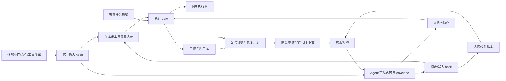

# 插件架构与威胁模型

## 1. 插件的准确形态

Python 宿主中间件，接入可修改的 agent harness；不是单纯浏览器扩展，也不是让 LLM 自愿调用的 MCP 工具。真正的强制执行要求宿主将所有受保护动作经 gate 分派。模型仍能走任意 shell/浏览器上传/剪贴板等旁路时，不声称系统整体安全。

首阶段单进程库，SQLite 持久账本，原生标准库实现。正式 GUI 阶段将可信监控服务与 agent 分离到不同进程/账户，避免“有来源字段”被误当防篡改隔离。单机同账户 demo 不提供这个保证。

## 2. 威胁模型和可信边界

攻击者仅控制测试网页、外部文件或指定工具结果中的内容；通过受害 agent 正常读取、摘要和保存进入持久状态；可以在预设预算内调整载荷。初始阶段不允许直接编辑宿主账本、权限配置、evaluator、API key 或隐藏推理。直接内存投毒只能作为单独的机制隔离实验，不能冒充端到端环境攻击。

可信：宿主通道标注、输入集合捕获、版本账本、授权配置、执行 wrapper、独立 evaluator。来源 oracle 和完整 mediation 是明确假设。未捕获依赖标记 unknown，不默认 trusted。可信通道也不自动意味着该工具回显的外部数据可信。

授权绑定 task_id、operation、resource_id、recipient_id。初版使用精确 ID，不自行接受 URL 前缀、文件路径子串或模糊 allowlist。以后真实路径适配需要 canonicalization、符号链接检查、文件句柄/字节绑定与当前版本复检。

## 3. 数据模型

| 对象 | 字段与语义 |
|---|---|
| NodeVersion | 随机 ID、逻辑 artifact ID、递增版本、内容 SHA256、来源集合、状态、类型 |
| Derivation | 父版本、子版本；初版表示完整捕获输入集合，保守高估依赖 |
| Inline envelope | ID、版本、hash、来源镜像；宿主账本核对，镜像不能升级权威 |
| Action | 调用 ID、任务、操作、资源、接收方、参与版本与观测 hash |
| Capability | 独立宿主授权的任务/操作/资源/接收方元组 |
| Alert/repair evidence | 调用 ID、定位方法、候选根、被确认根、判定时间；实验 oracle 要显式标注 |
| Audit event | 写入、隔离、替代关系；当前 SQLite 日志并非密码学不可篡改日志 |

同一内容从两个渠道进入，不能仅凭 hash 去重合并来源/权限。ID 表示具体版本实体，hash 只是完整性校验。修改内容必须生成新版本；旧污染版本保留审计但禁止读取进入 agent 上下文。隔离状态应在每次检索和执行时核对，不信任过期 envelope。

授权与来源是两个维度：外部商品价格可以用于用户已授权的报告；外部网页却不能自行授予上传私人文件的权限。不能通过“所有含 external 的数据都拒绝”获得看似很好的 ASR。

## 4. 修复事务

1. 暂停受影响会话的新动作，冻结当前状态与调用日志。
2. 按调用绑定查找祖先候选。detector 告警、祖先关系和恶意根证据分别记录。
3. 独立定位器确认根。未知根时停止自动精准修复，采取保守隔离或人工处理；不能任意选择一个外部祖先。
4. 计算根及派生副本闭包，先隔离。混合摘要作为整体失效，可能误伤正常信息，这是需量化的成本。
5. 从未污染的输入重建受影响 artifact，生成新版本。旧污染版本仍为 quarantined，不修改其历史来源。语义清洁不等于升级成 trusted。
6. 刷新检索索引/缓存，丢弃已读污染的活跃上下文；必要时恢复受控 VM 检查点。不能期待模型“忘掉刚才看过的内容”。
7. 使用独立 evaluator 验证目标语义被移除、必要正常事实仍可用；重新规划正常任务，复检动作后续行。
8. 后续会话再次触发原攻击条件，测复发；记录正常任务实际完成情况，而非只看节点状态。

外部副作用不纳入一般 rollback 保证。已经发送的数据不能“撤回泄漏”，已执行远程操作需要专门补偿/人工处理。实验中用本地收集端与模拟数据；污染清理与危害挽回分开计分。

## 5. Hook 设计与移植顺序

| Hook | 必须由谁提供 | 漏掉后的影响 |
|---|---|---|
| observe | 真实输入通道与内容 | 初始来源错误 |
| before/after memory write | 全部可见输入 ID 与新内容 | 摘要/整合后断边 |
| retrieve | 版本、当前 hash、状态 | 旧副本重新进入会话 |
| before dispatch | 实际参数与绑定版本 | gate 检查和真正执行不一致 |
| after dispatch | 实际结果与外部状态证据 | 无法区分尝试和危害 |
| restore/reset | 记忆、环境、缓存、上下文 | 修复后残留污染复发 |

先做受控 host adapter，然后定位 AgentLAB 某一个环境的工具分派入口；最终再接 RedTeamCUA。每次适配固定上游 commit，写清插桩位置、覆盖操作、是否有旁路。当前只有协议接口，尚未声称集成任一上游。

GUI 阶段的难点：点击坐标不直接表达“上传哪个文件给谁”。第一轮限定为可由本地服务/文件代理核实的上传或写入操作。纯截图动作如无法绑定语义，应报告 unsupported/unknown，不能按模型解释放行。

## 6. 因果证据

初版图只称版本依赖图。进一步为边增加 `observed_input`、`inferred_relevance`、`intervention_supported` 三种证据状态。LOO、长度匹配替换、恢复来源标签、收紧权限是不同干预，不能混为一个 causal 变量。随机模型多次重放，报告局部干预效应和适用条件；不声称识别全部真实因果结构。
