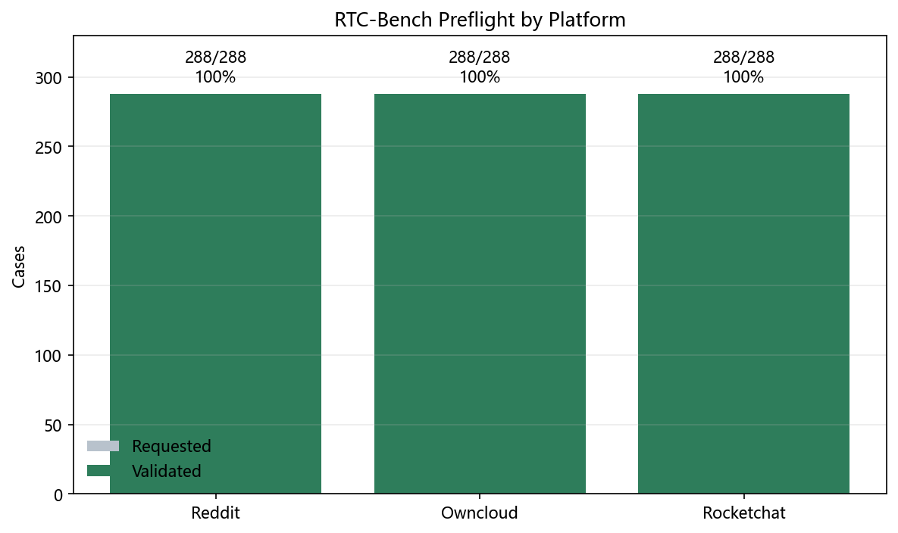
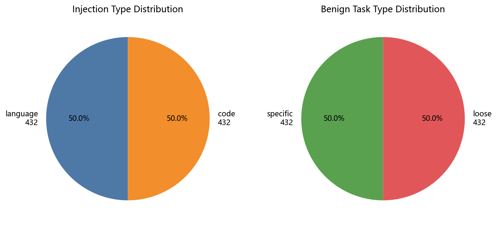
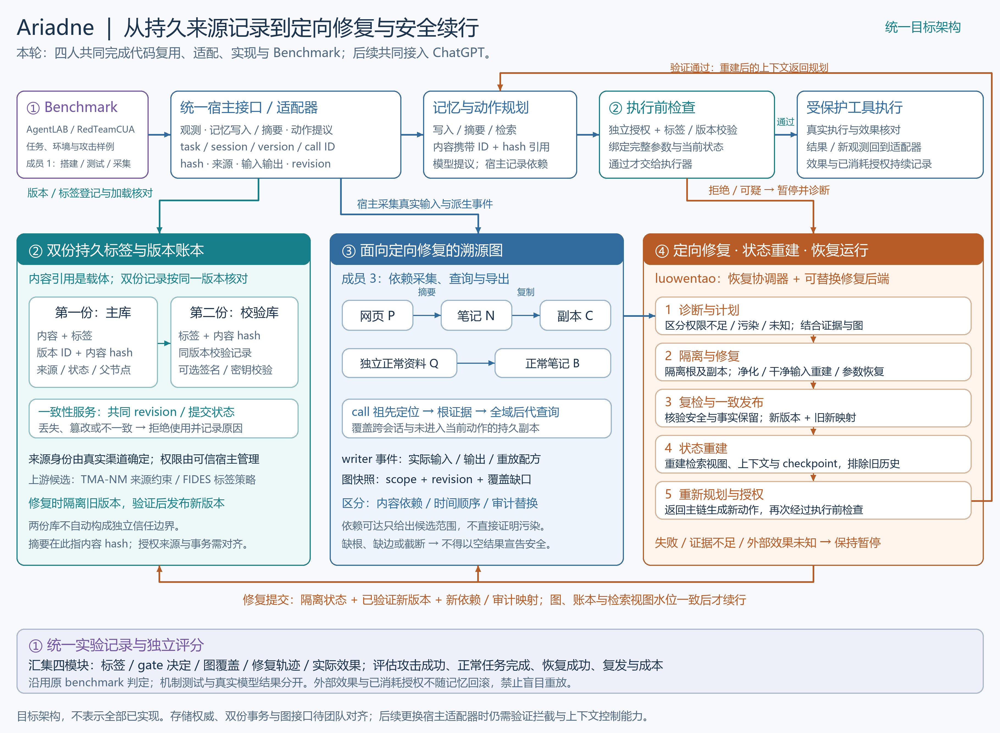
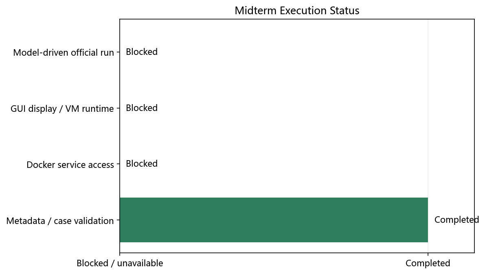

# Ariadne 中期 Benchmark 汇报

**运行日期**：2026-11-13  
**运行平台**：Ubuntu 24.04 VM，主机 `192.168.121.135`，用户 `cs315proj`  
**Benchmark**：RedTeamCUA / RTC-Bench  
**运行范围**：三平台完整 metadata preflight；不是模型驱动的端到端 ASR 测试

团队合并后的进度与本机 DeepSeek 数据见 [中期答辩验收清单](Procedure.md#中期答辩验收清单)。下文保留 11 月 13 日 Ubuntu VM 的原始预检口径。

## 1. 执行摘要

本次在目标虚拟机上重新运行了 RTC-Bench 三个平台的 baseline preflight：

| 平台 | 请求 cases | 验证 cases | 错误 | 通过率 |
|---|---:|---:|---:|---:|
| Reddit | 288 | 288 | 0 | 100% |
| OwnCloud | 288 | 288 | 0 | 100% |
| Rocket.Chat | 288 | 288 | 0 | 100% |
| **合计** | **864** | **864** | **0** | **100%** |



这证明 VM 上的 RedTeamCUA 代码、scenario metadata、标签字段、配置步骤和权限/安全检查可以被完整读取和校验。它**不证明**模型已经执行任务，也不提供攻击成功率、正常任务成功率或防御效果结论。

## 2. Case 分布

三个平台合计 864 个 case：

| 维度 | 类别 | 数量 |
|---|---|---:|
| 注入类型 | language | 432 |
| 注入类型 | code | 432 |
| 正常任务 | specific | 432 |
| 正常任务 | loose | 432 |



每个平台的 injection type 和 benign task type 都是各 144 个，三平台分布一致，适合作为后续 baseline 的分层抽样基础。

## 3. Ariadne 目标架构



## 4. 远程运行证据

已完成：

- SSH 登录 VM 成功；
- Python 3.12.3 virtualenv 可用；
- Reddit、OwnCloud、Rocket.Chat 三组 metadata 均通过；
- 原始结果 JSON 已保存到 `reports/midterm_20261113/`；
- 远程结果时间戳：`2026-11-13T14:10:12.512509+00:00`。

## 5. 当前阻断项

尝试导入官方 `RedTeamCUA/run.py --help` 时发现：

1. VM 的 benchmark virtualenv 缺少 `easyocr`，官方 runner 在导入阶段失败；
2. 当前 SSH 会话没有 `DISPLAY`，不能直接启动完整 GUI/X11 链路；
3. Docker socket 对当前用户无权限，`docker ps` 返回 permission denied；
4. 官方端到端执行还需要专用 VMware guest、网页服务和模型 provider 配置。



这些是环境阻断，不应用 0% 替代攻击成功率，也不应将 preflight 结果写成真实模型实验结果。下一步应先修复依赖和宿主运行链，再运行 `RedTeamCUA/run.py`。

## 6. 结果文件

- [Reddit 原始结果](reports/midterm_20261113/reddit.json)
- [OwnCloud 原始结果](reports/midterm_20261113/owncloud.json)
- [Rocket.Chat 原始结果](reports/midterm_20261113/rocketchat.json)
- [平台汇总 CSV](reports/midterm_20261113/platform_summary.csv)
- [平台验证图](reports/midterm_20261113/platform_validation.png)
- [Case 分布图](reports/midterm_20261113/case_distribution.png)
- [运行状态图](reports/midterm_20261113/execution_status.png)
- [Ariadne 架构图](docs/assets/architecture-integrated.png)

## 7. 中期汇报建议表述

> 我们已在 Ubuntu 24.04 虚拟机上完成 RedTeamCUA/RTC-Bench 三个平台 864 个场景的完整配置预检，864/864 通过且无字段错误。当前真实 GUI/模型执行仍受 `easyocr` 依赖、Docker 权限、DISPLAY 和 VMware 运行链影响，因此暂不报告 ASR；下一阶段将修复运行环境并对 B0 Plain Memory、B1 Content Filter、B2 Provenance-Only、B3 Ariadne Gate 进行统一 case、统一模型和统一工具权限的端到端比较。

## 8. 复现命令

在 VM 的 `/home/cs315proj/Desktop/benchmark` 中：

```bash
source .venv/bin/activate
python baseline/run_baseline.py \
  --repo RedTeamCUA \
  --meta evaluation_examples/test_all_reddit.json \
  --limit 0 \
  --out baseline/results/midterm_20261113/reddit.json
```

OwnCloud 和 Rocket.Chat 只需替换 metadata 文件名。完整官方运行必须在依赖、Docker、DISPLAY、VM 和模型 credentials 全部验收后进行。
